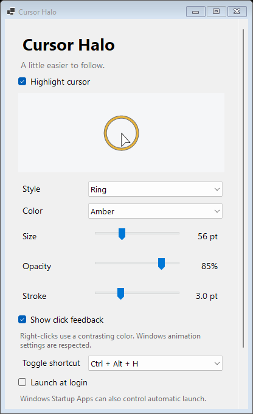

# Cursor Halo

**Make your pointer easy to follow.** A native menu-bar app for macOS and tray app for Windows, with a customizable halo and click feedback.

[](https://github.com/jjs-mm/cursor-halo/actions/workflows/ci.yml)
[](LICENSE)



*Windows settings rendered by the native CI smoke test.*

## Features

- A high-contrast ring or soft disc around the pointer, with five colors and adjustable size, opacity, and stroke.
- Click ripples that stay where you clicked, with a contrasting color for secondary clicks.
- A global keyboard toggle, a menu-bar/tray control, and saved local preferences.
- Optional launch at login, disabled by default.
- Click-through overlays that cannot take keyboard focus.
- Native display coordinates and scaling, bounded animations, and event-driven pointer updates.
- Reduced-animation support. No accounts, telemetry, advertising, network service, or web runtime.

## Download and install

Check [Releases](https://github.com/jjs-mm/cursor-halo/releases) for published archives. Development builds are available as artifacts on successful [CI runs](https://github.com/jjs-mm/cursor-halo/actions/workflows/ci.yml). A green CI run proves the automated checks; it does not certify every display or recording setup. See [validation status](docs/validation.md).

| Platform | Target | Package |
| --- | --- | --- |
| macOS | macOS 13+, Apple Silicon and Intel | Universal app ZIP |
| Windows | Windows 11, x64 and ARM64 | Self-contained native app ZIP for each architecture |

**macOS:** unzip and move `Cursor Halo.app` to Applications, then open it. The app lives in the menu bar. Builds are ad hoc signed; Apple Developer ID signing and notarization are not configured.

**Windows:** extract the whole archive before running `CursorHalo.exe`. To install per user, run the included `Install-CursorHalo.ps1`; it requires no administrator account. The archive includes the .NET runtime. Windows builds are not Authenticode-signed, so Windows may display a reputation warning. Verify the source and archive before choosing to run it.

Each archive has a SHA-256 checksum file. On macOS use `shasum -a 256 <archive.zip>`; on Windows use `Get-FileHash <archive.zip> -Algorithm SHA256` and compare it with the published value.

## Controls

- Open settings from the menu-bar or notification-area icon.
- **Control–Option–H** on Mac, or **Ctrl–Alt–H** on Windows, toggles highlighting. Alternative H/C shortcuts are available in settings.
- Adjust ring/disc, color, size, opacity, stroke, and click feedback. Appearance changes apply immediately.
- Enable **Launch at login** only when you want automatic startup. macOS may require approval in Login Items. Windows registers a per-user startup command; Windows Startup Apps can independently disable it, so check that page if it does not start.
- Use **Reset appearance** to restore the visual defaults, or **Quit** to remove the overlay and stop the app.

For recordings and meetings, start with **full-display capture**. An individual-window capture can exclude the separate overlay. Test a short recording with your recorder before relying on it. Secure desktop, sign-in screens, and some exclusive fullscreen applications may prevent overlays.

## Build from source

Clone the repository and use the native toolchain for the platform you want to run.

### macOS

Requires Swift 6+ from Xcode or Apple's Command Line Tools. Production builds target macOS 13; tests using Swift Testing require a compatible current toolchain.

```sh
./scripts/test.sh
./scripts/build.sh --universal
./scripts/package-macos.sh
open "dist/Cursor Halo.app"
```

For a quicker build of just the current Mac architecture, omit `--universal`. Use `./scripts/install-macos.sh` to install an already-built app safely, or add `--user` for `~/Applications`. The installer retains the previous app for rollback. Quit the app before updating it.

### Windows

Requires the .NET 10 SDK; `global.json` declares the tested SDK feature band. From PowerShell:

```powershell
./windows/scripts/test.ps1
./windows/scripts/build.ps1 -Runtime win-x64
# Use -Runtime win-arm64 for Windows on ARM.
```

The platform-independent core tests also run on macOS or Linux:

```sh
dotnet run --project windows/CursorHalo.Tests -c Release
```

No third-party runtime package is used. The Windows build restores Microsoft's platform/runtime packs from NuGet. See [architecture](docs/architecture.md), [shared behavior](docs/behavior.md), and [testing](docs/testing.md).

## Privacy and maintenance

Pointer events are used transiently for drawing and are not logged. Shortcuts register specific combinations; the app does not capture typed text. Settings remain on your machine. There is no automatic updater.

To uninstall, disable **Launch at login**, quit, and remove the app directory. Appearance preferences can be retained for a later reinstall. See platform installation instructions before removing an installed copy.

[Contributions](CONTRIBUTING.md) and reproducible [bug reports](https://github.com/jjs-mm/cursor-halo/issues) are welcome. Please report vulnerabilities using [SECURITY.md](SECURITY.md).

## License and provenance

[MIT](LICENSE). Cursor Halo is an independent implementation using its own code and artwork. Publicly described cursor-highlighting behavior informed the initial scope; no third-party app binary, source code, or artwork was copied. See [provenance notes](docs/research.md).
